# Proyecto Aura - Proyecto Universitario

## Descripción general del proyecto

Este proyecto es un videojuego desarrollado como parte de un trabajo
universitario por Javier Muñoz, Izan Vázquez y Cristopher Villacís

Proyecto Aura es un videojuego que plantea la situación de querer acabar con una tendencia por medio de la misma. Paquito, el protagonista se enfrentará a enemigos en Batallas de Aura con el objetivo de poner fin a dicha moda.

Se trata de un RPG por turnos en el que el jugador tendrá que elegir que ataques usará y en qué momento, además de contar con la posible ayuda del gashapon y, por si eso fuera poco, a cada ataque le acompañará un Quick Time Event diferente que deberá resolver si quiere sacar el máximo partido a cada ataque.

## Capturas del juego

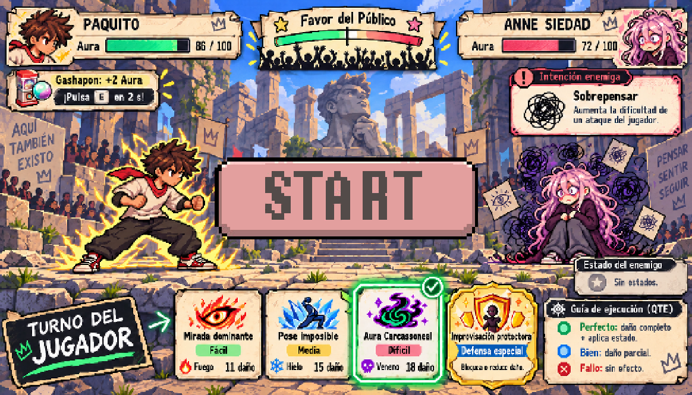

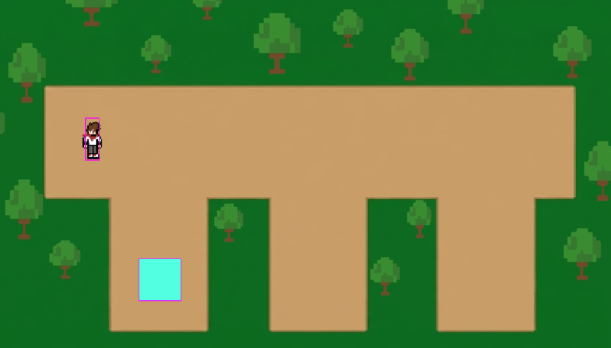

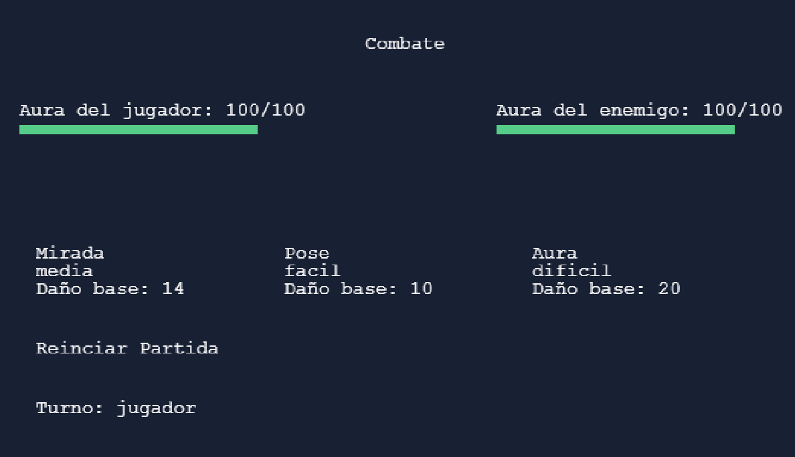

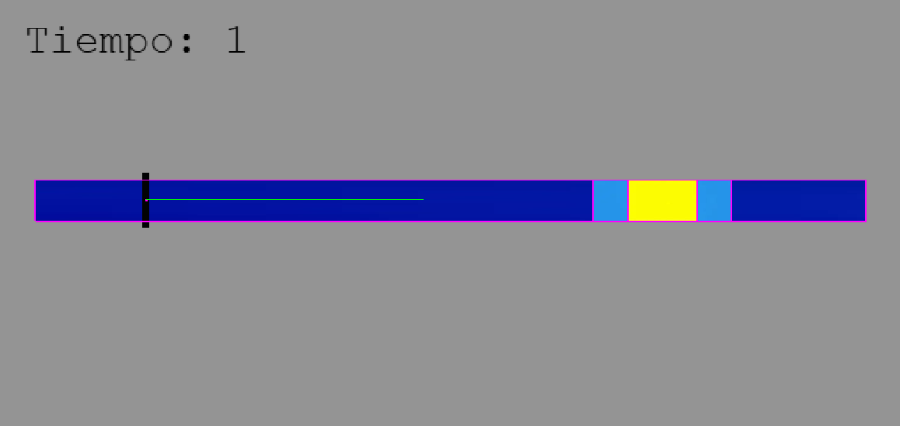

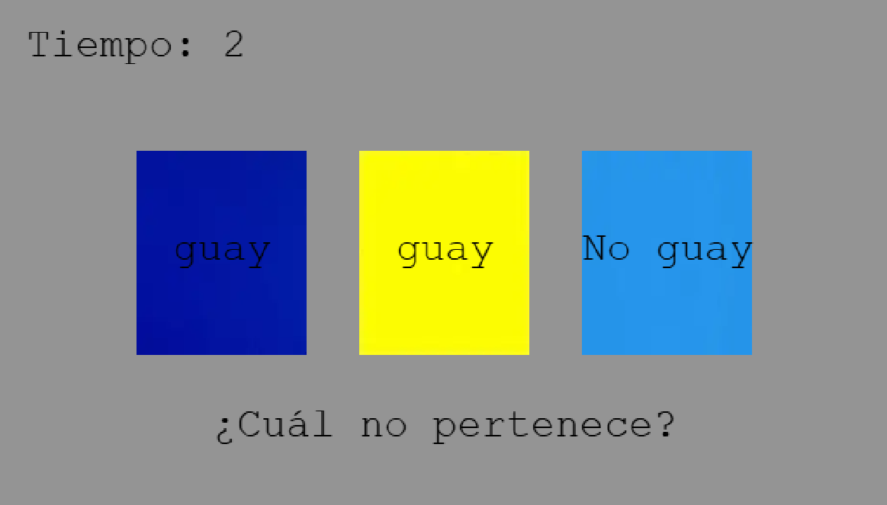

## Jugar

Puedes jugar al juego aquí

[**Jugar al videojuego**](https://javimuno.github.io/PVLI-26-27/)

Proyecto realizado con fines académicos.

# Game Design Document - Proyecto Aura

## Equipo de desarrollo

-   Izan Vázquez Sánchez
-   Cristopher Jeremy Villacis Galindo
-   Javier Muñoz García

# 1. Descripción general

## 1.1 Concepto

Proyecto aura es un RPG de combates por turnos 1 contra 1 ambientado en el mundo de las Batallas de Aura. El jugador controla a Paquito y deberá derrotar progresivamente a varios rivales hasta alcanzar al líder de la Plaza del Mewing.

El combate combina la elección táctica de acciones con Quick Time Events. En cada turno, el jugador dispone de tres variantes ofensivas pertenecientes a tres familias de ataque diferentes. Cada variante posee una dificultad de ejecución, una cantidad de daño y un elemento asociado, por lo que el jugador debe decidir entre opciones más seguras o arriesgarse con ataques más difíciles y potentes.

La correcta ejecución de los QTE permite además aplicar marcas elementales y encadenarlas para activar efectos adicionales. Paralelamente, el jugador puede anticipar la próxima acción del rival mediante el sistema de Intenciones enemigas y adaptar su estrategia a la amenaza prevista.

Durante los enfrentamientos intervienen también sistemas secundarios como el Favor del Público, que recompensa el buen desempeño de ambos contendientes, y el Gashapon, que genera oportunidades esporádicas de obtener pequeñas bonificaciones durante el combate.

## 1.2 Género

RPG de combate por turnos 1v1 basado en Quick Time Events, decisiones de riesgo-recompensa, estados elementales e Intenciones enemigas.

## 1.3 Setting

En la Plaza del Mewing, donde los más grandes farmeadores de Aura se reúnen a diario para demostrar sus superiores dotes de farmeo.

El jugador juega en la perspectiva de Paquito, quien tras descubrir que la juventud que vivieron otros chicos como él se basa en el Aura Farming decide que debe ser él quien acabe con esta tendencia que cree perjudicial para las próximas generaciones de jóvenes.

Para acabar con ello, Paquito se embarca en la misión de derrocar a aquel que más Aura haya farmeando, pues será a quien todos admiren. Si él cae, todos lo harán, y la única forma de derrotarlo será jugando su propio juego.

Pero no será fácil, para poder tener una batalla de Aura con el líder, Paquito primero tendrá que enfrentarse a sus sirvientes directos. Dos rivales feroces, que buscarán impedir que un novato en el mundillo tenga la osadía de desafíar al jefe.

## 1.4 Características principales

Las principales características del juego son el combate por turnos 1 contra 1, la ejecución activa de las acciones mediante Quick Time Events y un sistema de decisiones basado en riesgo y recompensa.

El jugador dispone de tres familias de ataques ofensivos, cada una asociada a un QTE diferente. Las variantes disponibles cambian a lo largo del combate y combinan dificultad, daño y elemento, obligando al jugador a valorar qué opción utilizar en cada momento.

A esta base se añaden las marcas y combos elementales, una defensa especial desbloqueable mediante buen desempeño, las Intenciones enemigas que permiten anticipar las próximas acciones del rival, el Favor del Público y las oportunidades de bonificación proporcionadas por el Gashapon.

# 2. Gameplay

## 2.1 Objetivo del juego

El objetivo principal es derrotar consecutivamente a los distintos rivales hasta alcanzar y vencer al jefe final.

Cada contendiente posee una cantidad determinada de Aura, que funciona como recurso de resistencia durante el combate. El jugador debe reducir el Aura del enemigo a 0 antes de que el rival consiga hacer lo mismo con Paquito.

Si Paquito pierde toda su Aura, el combate se considera perdido y el jugador deberá reiniciar el recorrido desde el primer enfrentamiento. Al derrotar al jefe final se completa la partida.

## 2.2 Core loops

El juego presenta dos ciclos principales.

El ciclo global consiste en superar progresivamente los enfrentamientos disponibles:

**Enemigo 1 → Enemigo 2 → Jefe final → Victoria.**

El ciclo de combate se repite mientras ambos contendientes conserven Aura. Al comienzo de cada turno del jugador se muestra la próxima Intención enemiga. El jugador analiza entonces sus variantes disponibles, selecciona una acción y ejecuta su QTE correspondiente. Tras resolver daño, estados y demás modificadores, el enemigo ejecuta su acción prevista. Finalmente se renueva la variante ofensiva utilizada y comienza un nuevo turno.

# 3. Personaje jugador

## Paquito

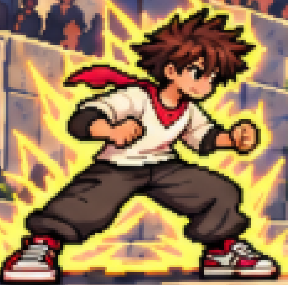

Paquito es el protagonista del juego y la representación del jugador en él.

Se trata de un joven que ha vivido la mayor parte de su vida sin acceso a internet sobreprotegido por sus padres. Tras independizarse descubrió que la infancia que se perdió está plagada de una nueva tendencia que denominó como "La fiebre del Aura" y, confundido o preocupado por lo que pudiera provocar en la gente, decide que debe detenerlo.

## 3.1 Métricas

Los combates se desarrollan en una escena 2D lateral fija. Paquito ocupa visualmente la zona izquierda del escenario y el rival la derecha. Los personajes no disponen de movimiento libre durante el combate, por lo que las métricas espaciales están principalmente relacionadas con la distribución visual de personajes, interfaz y elementos interactivos.

Como valores iniciales de balance, tanto Paquito como los enemigos partirán de una cantidad máxima de 100 puntos de Aura, pudiendo modificarse posteriormente durante las pruebas de juego.

Los ataques ofensivos utilizan tres rangos de daño. La dificultad determina también la exigencia del QTE asociado al ataque.

| **Dificultad** | **Daño base** |
| Fácil | 10-12 |
| Media | 13-15 |
| Difícil | 16-20 |

Las cifras se consideran valores iniciales sujetos a balance durante el desarrollo, pero constituyen la referencia utilizada para diseñar y probar el sistema.

## 3.2 Controles

La selección de opciones en menús y durante el combate se realizará principalmente mediante las flechas direccionales.

La tecla Enter o Espacio se utilizará para confirmar selecciones, mientras que Esc permitirá cancelar o regresar cuando la interfaz lo permita.

Cada QTE utiliza las entradas que mejor se adaptan a su funcionamiento:

| :--- | :--- |
| **Acción** | **Efecto** |
| Selección de ataques  | Flechas direccionales |
| Confirmar | Enter / Espacio |
| Mirada dominante | Espacio |
| Pose imposible | Flechas direccionales |
| Aura Carcassoneal | Letras y números mostrados |
| Improvisación Protectora | Entrada indicada por el QTE |
| Gashapon | Tecla indicada en pantalla |

El juego mostrará siempre visualmente las entradas esperadas, evitando que el jugador necesite memorizar combinaciones externas al contexto de cada acción.

# 4. Sistema de combate y mecánicas

## 4.1 Estructura del turno

Cada ronda de combate comienza con el turno del jugador.

Antes de permitir la selección de una acción, el juego determina qué realizará el enemigo a continuación y muestra esta información mediante el panel de Intención enemiga.

El jugador puede entonces consultar sus tres variantes ofensivas disponibles y, si ha sido desbloqueada, la acción especial Improvisación Protectora.

Al seleccionar una acción ofensiva se inicia el QTE correspondiente. El resultado obtenido determina el daño realizado, la posible aplicación de una marca elemental y la modificación del Favor del Público.

Tras resolver la acción del jugador, el enemigo ejecuta la Intención anunciada, salvo que haya sido impedida previamente por algún efecto como Congelación.

Al inicio del turno del jugador es posible que se active la mecánica del Gashapon, en un momento en que el jugador aún no haya elegido ataque y tampoco el enemigo lo esté atacando.

Finalmente, únicamente la variante ofensiva utilizada por el jugador se sustituye por una nueva y comienza el siguiente turno.

## 4.2 Variantes Ofensivas

El jugador dispone permanentemente de una variante de cada una de sus tres familias ofensivas:

-   Mirada dominante.
-   Pose imposible.
-   Aura Carcassoneal.

Cada variante está definida por cuatro características: familia de ataque, dificultad, daño base y elemento.

Por ejemplo:

**Pose imposible · Media · 14 Aura · Hielo**

Las tres variantes se generan de manera independiente, por lo que pueden coincidir varias dificultades en un mismo turno.

Cuando el jugador utiliza una variante, las otras dos permanecen disponibles sin cambios. Únicamente la familia utilizada recibe una nueva variante al comenzar el siguiente turno.

La nueva variante puede repetir la dificultad anterior, pero su elemento no podrá ser exactamente el mismo que el de la variante que acaba de consumirse. De esta manera se favorece cierta rotación elemental sin eliminar el componente aleatorio.

## 4.3 Dificultad y daño

La dificultad de una variante determina tanto su daño potencial como la complejidad del QTE que debe superar el jugador.

La dificultad no modifica de la misma forma todos los QTE. Cada familia aumenta su complejidad mediante los parámetros propios de su mecánica: velocidad, tamaño de la zona válida, longitud de secuencia, número de piezas o tiempo disponible.

| **Dificultad** | **Daño base** |
| Fácil | 10-12 |
| Media | 13-15 |
| Difícil | 16-20 |

## 4.4 Resultado de los QTE

Todos los QTE ofensivos utilizan una escala común de tres resultados:

-   **Perfecto:** el ataque inflige el 100 % de su daño base y aplica su
    marca elemental.
-   **Bien:** el ataque inflige el 50 % de su daño base, redondeado al
    entero más próximo, pero no aplica marca elemental.
-   **Fallo:** el ataque no inflige daño ni aplica ninguna marca.

Esta escala se utiliza de forma consistente en todo el sistema para facilitar al jugador la comprensión del resultado de sus acciones.

## 4.5 Mirada dominante

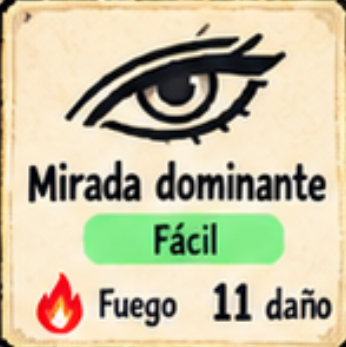
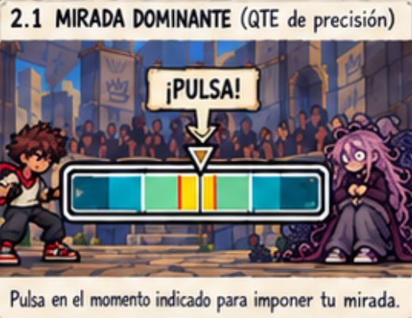

Mirada dominante utiliza un QTE de precisión temporal.

Al comenzar la acción aparece una barra horizontal con una zona objetivo situada en una posición variable. Un indicador se desplaza por la barra y el jugador debe pulsar la tecla correspondiente cuando este se encuentre dentro de la zona válida.

La dificultad de la variante modifica principalmente la velocidad de desplazamiento y el tamaño de la zona válida.

Una ejecución especialmente precisa dentro de la región central produce un resultado Perfecto; detener el indicador dentro del resto de la zona válida produce un resultado Bien; detenerlo fuera de ella produce un Fallo.

## 4.6 Pose imposible

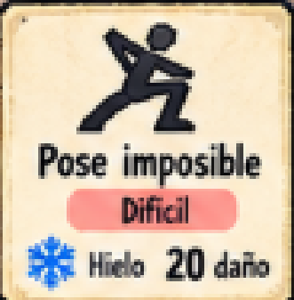
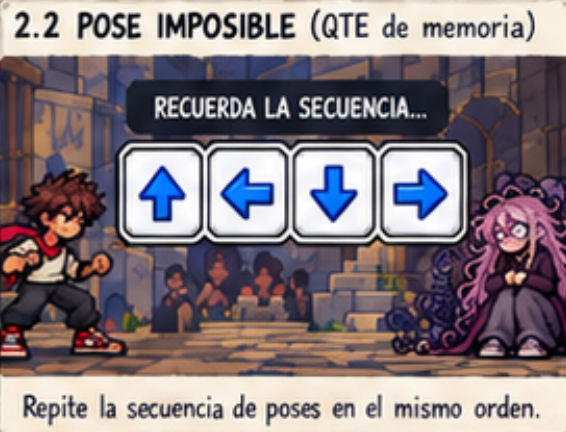

Pose imposible utiliza un QTE de memoria.

Al comenzar la acción se muestra durante unos segundos una secuencia de direcciones que puede contener repeticiones. Una vez ocultada, el jugador debe reproducirla utilizando las flechas direccionales.

La dificultad determina principalmente la longitud de la secuencia.

Reproducir correctamente todos los elementos produce un resultado Perfecto. Alcanzar al menos un 50 % de aciertos produce un resultado Bien. Un resultado inferior se considera Fallo.

## 4.7 Aura Carcassoneal

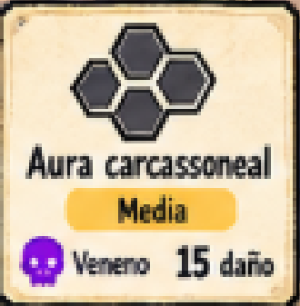
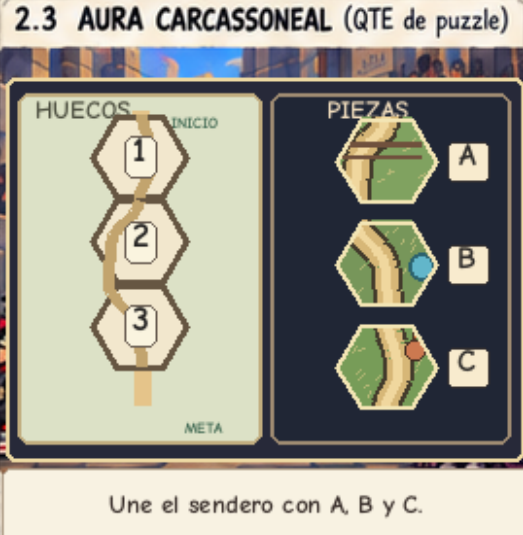

Aura Carcassoneal utiliza un QTE basado en la colocación de piezas hexagonales.

Se presenta al jugador un pequeño puzle parcialmente completado. Los espacios pendientes se identifican mediante números y las piezas disponibles mediante letras.

El jugador debe relacionar correctamente cada pieza con el espacio correspondiente introduciendo las parejas número-letra antes de que termine el tiempo disponible.

La dificultad puede modificar el número de espacios a resolver, la cantidad de piezas candidatas y el tiempo disponible.

Completar correctamente todos los emparejamientos produce Perfecto. Alc anzar al menos un 50 % de aciertos produce Bien. Un resultado inferior produce Fallo.

En este ejemplo, el jugador tendría que introducir **1C 2A 3B**.

## 4.8 Marcas y combos elementales

Las variantes ofensivas pueden estar asociadas a tres elementos:

-   Fuego.
-   Hielo.
-   Veneno.

Un elemento únicamente se aplica al enemigo cuando el jugador consigue un resultado Perfecto.

La primera aplicación genera una marca elemental que permanece activa durante el turno actual y el siguiente turno del jugador.

Si antes de que expire se aplica un elemento diferente, la nueva marca sustituye a la anterior.

Si se vuelve a aplicar el mismo elemento, se activa su combo elemental y la marca se consume.

Los efectos iniciales son:

| **Combo** | **Resultado** |
| :--- | :--- |
| 🔥 Fuego + Fuego | El segundo ataque inflige un 50 % de daño
adicional |
| ❄️ Hielo + Hielo | El enemigo pierde su próxima acción |
| ☠️ Veneno + Veneno | Inflige 4 Aura al activarse y otros 4 Aura en
el siguiente turno |

## 4.9 Improvisación Protectora

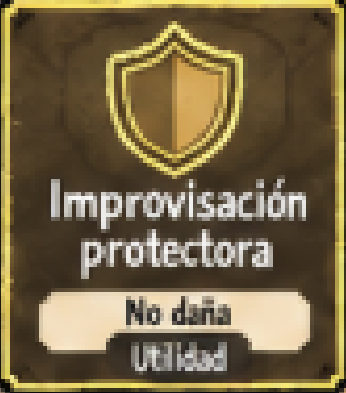
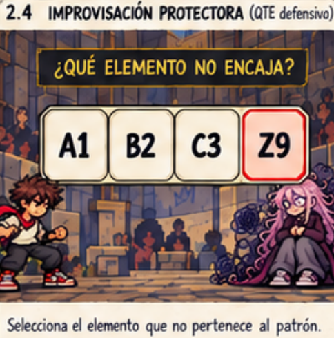

Improvisación Protectora es una acción defensiva especial y no forma parte de las tres familias ofensivas.

Se desbloquea al conseguir dos QTE ofensivos Perfectos consecutivos. Un resultado Bien o Fallo interrumpe la racha.

Cuando está cargada aparece como una acción adicional con una representación visual distinta de los ataques normales.

Utilizarla consume el turno del jugador.

Su QTE consiste en identificar rápidamente un elemento discordante dentro de una secuencia de caracteres, números o palabras.

Si el jugador acierta, bloquea el 100 % del próximo ataque enemigo que inflija daño. Si falla, no obtiene protección.

Una vez utilizada, la habilidad vuelve a quedar descargada.

Improvisación Protectora no posee daño, dificultad ni elemento y únicamente puede utilizarse cuando la Intención enemiga anunciada vaya a producir daño.

Esto último es una protección contra el desconocimiento del jugador que pudiera elegir usarlo en un turno cuya acción del enemigo no conlleva daño alguno.

## 4.10 Resolución del daño

Para mantener un funcionamiento consistente, los modificadores de daño se aplican siempre en el siguiente orden:

**Daño base → Resultado del QTE → Bonificaciones planas de Gashapon → Combo elemental → Favor del Público.**

El resultado final se redondea al número entero más próximo.

El daño periódico de Veneno no recibe multiplicadores del Favor del Público ni bonificaciones de Gashapon.

## 4.11 Ataques enemigos

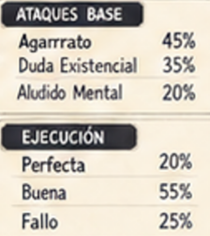

Cada enemigo dispone de tres ataques base propios, diseñados de acuerdo con su personalidad y nivel de dificultad.

Los ataques enemigos infligen daño de Aura pero no aplican marcas elementales.

Cuando el enemigo debe realizar un ataque base, el juego selecciona una de sus tres opciones mediante un sistema pseudoaleatorio ponderado. Cada rival puede poseer probabilidades diferentes, permitiendo crear comportamientos más o menos agresivos sin modificar la estructura general del sistema.

De forma independiente se determina la calidad con la que el enemigo ejecuta el ataque:

-   **Perfecto:** 100 % del daño indicado.
-   **Bien:** 50 % del daño indicado.
-   **Fallo:** 0 daño.

La calidad también se determina mediante probabilidades propias de cada enemigo.

El sistema incorpora protecciones frente a secuencias excesivamente repetitivas, evitando que un rival utilice de manera continuada el mismo ataque o encadene cantidades extrañas de Perfectos o Fallos.

El enemigo no reproduce físicamente un QTE. Su resultado se calcula internamente y se representa mediante la animación correspondiente y el indicador Perfecto, Bien o Fallo.

## 4.12 Intenciones y habilidades especiales

Antes de cada turno del jugador, el juego determina la próxima acción del enemigo y la muestra mediante el panel de Intención enemiga.

Cuando se trata de un ataque base, el jugador puede conocer qué ataque se utilizará y cuál es su daño máximo potencial, pero no sabrá si el enemigo lo ejecutará como Perfecto, Bien o Fallo hasta que llegue su turno.

Cada enemigo posee además una habilidad especial propia que sustituye periódicamente a uno de sus ataques base.

Las habilidades especiales no utilizan los resultados Perfecto, Bien o Fallo. Si el enemigo llega a ejecutar su turno, su efecto se produce siempre.

Estas habilidades pueden ser impedidas mediante efectos de control como Congelación.

### Ejemplo: Anne Siedad y su habilidad Sobrepensar

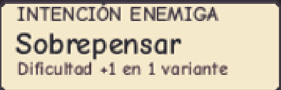

La habilidad especial de Anne Siedad es Sobrepensar.

Como valor inicial de diseño (sujeto a balance durante desarrollo), Anne intentará utilizarla cada tres acciones enemigas.

Sobrepensar aumenta temporalmente un nivel la dificultad de ejecución de una de las variantes ofensivas del jugador durante su siguiente turno, sin modificar su daño base.

**Idea pendiente:** que Sobrepensar se aplique o tenga prioridad sobre el ataque cuyo estado sea igual al de un estado aplicado previamente con la intención del jugador de ejecutar un combo. Esto daría lugar a un comportamiento "pseudointeligente" del enemigo para condicionar la elección del jugador (aumento de dificultad → búsqueda de combo elemental).

Por ejemplo:

**Pose imposible · Media · 14 Aura → Pose imposible · Difícil · 14 Aura**

Pasa a ejecutarse con los parámetros de dificultad Difícil, manteniendo sus 14 puntos de daño y el estado elemental asociado.

La selección priorizará variantes cuya dificultad pueda ser aumentada.

## 4.13 Gashapon

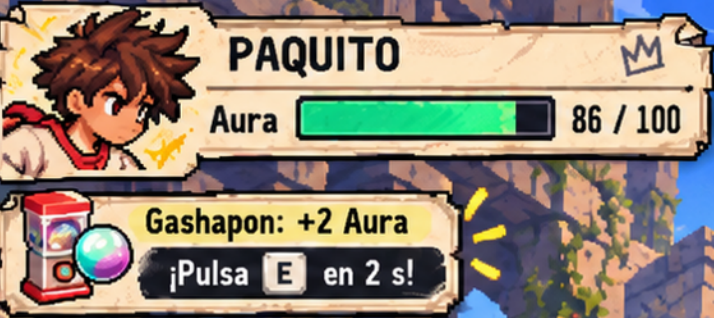

El Gashapon es una mecánica secundaria que genera oportunidades esporádicas de obtener pequeñas ventajas durante el combate.

Su slot permanece visible bajo el indicador de Aura de Paquito y muestra visualmente un ciclo continuo de posibles potenciadores.

Internamente, cada activación se programa tras un intervalo pseudoaleatorio inicial de dos o tres turnos del jugador (sujeto a balance en desarrollo, como todo lo numérico).

Cuando llega el momento de activación, el ciclo se detiene y aparece uno de los siguientes efectos:

| **Bonus** | **Efecto** |
| :--- | :--- |
| Recuperación | +2 Aura |
| Impulso | +2 Daño al siguiente ataque |
| Protección | -2 Daño del siguiente ataque enemigo |

Junto al potenciador aparece una tecla aleatoria y el jugador dispone de 2 segundos para pulsarla.

Si reacciona correctamente, obtiene el bonus. Si no lo hace a tiempo, la oportunidad se pierde.

El Aura nunca puede superar su máximo.

Durante cualquier QTE, el ciclo del Gashapon se pausa y no puede producirse una activación, evitando que dos mecánicas soliciten entradas simultáneamente. Ejemplo:

| **Ciclando** | **Oportunidad** | **Éxito** | **Error** |
| :--- | :--- | :--- | :--- |
| 🎰 (¿?¿?¿?¿) | 🎰 (+2 Aura)   - Pulsa E - 2 s | +2 Aura | Sin efecto |

# 5. Mundo del juego

## 5.1 Personajes

-   **Paquito:** Nuestro personaje y héroe principal, nuestro Quijote
    sin Sancho Panza, armado con sus principios y una serie de
    movimientos que ha visto en YouTube y de los que hará uso para
    luchar decididamente contra el nuevo trend social de las Batallas de
    Aura. Será nuestro adalid en este enfrentamiento contra el
    sinsentido, el cringe y la vergüenza ajena.
-   **Anne Siedad:** La primera enemiga, caracterizada como un personaje
    ansioso y constantemente angustiado. Es la segunda al mando y su
    particular forma de ser hace que su estilo de pelea sea único y
    difícil de seguir. Gana Aura gracias a su espontaneidad. Si alguien
    consigue seguirle el ritmo, su ansiedad aumentará lo que, a
    diferencia de lo que podría parecer, jugará a su favor.
-   **Enemigo 2:** Diseño pendiente de cierre.
-   **Jefe final:** Toni, ¿nos dejas usarte de jefe final porfa? 🙂

## 5.2 Obstáculos

Los obstáculos en nuestro juego son los distintos enemigos que hay que derrotar para avanzar y finalmente completar el objetivo. Estos enemigos supondrán un desafío considerable y, si el jugador pierde todos sus puntos de Aura antes de derrotarlos, se verá forzado a volver a empezar.

## 5.3 Niveles

Como niveles tendremos los distintos combates con enemigos intermedios antes de llegar al jefe final. Provisionalmente y con la intención de hacer enemigos y un sistema de combate relativamente complejo y elaborado, con una dificultad incremental, tendremos a dos enemigos y al jefe final. Cada uno de ellos distinto del resto y más complejo que el anterior.

Para seleccionar los niveles habrá un mapa principal donde se encontrará el jugador y el acceso a los 3 niveles. Al principio solo el primer nivel estará disponible. Para llegar al segundo nivel, el jugador debe de haber superado antes el primer nivel y así mismo este segundo nivel debe completarse para poder desbloquear el nivel final.

**Enemigo 1 → Enemigo 2 → Jefe final.**

# 6. Interfaz

## 6.1 Cámara

Los combates utilizan una vista 2D lateral fija.

Paquito aparece en la zona izquierda del escenario y su rival en la derecha.

Los Quick Time Events no cargan una escena independiente ni modifican la cámara. (Pendiente de desarrollo: ver si es más viable una opción u otra).

Al iniciarse un QTE se mantiene la misma escena de combate y aparece una capa interactiva superpuesta. El escenario, personajes y elementos secundarios del HUD reducen temporalmente su protagonismo visual para centrar la atención en la mecánica activa.

Al finalizar el QTE, el overlay desaparece y el combate continúa inmediatamente desde el mismo estado.

## 6.2 HUD

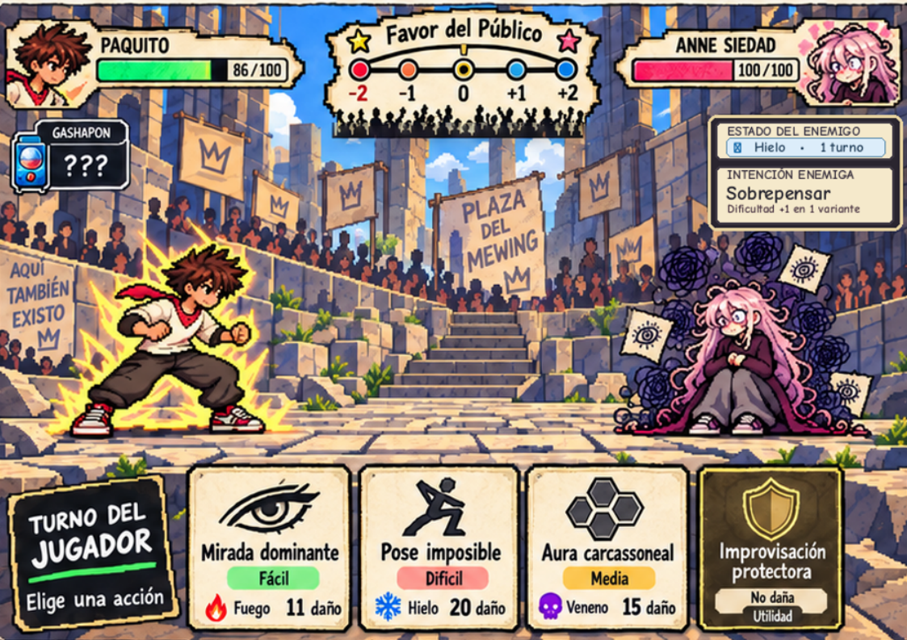

El HUD mantiene una distribución fija durante todos los enfrentamientos.

-   En la esquina superior izquierda se muestra el retrato de Paquito,
    su nombre y su Aura actual respecto al máximo. Bajo este panel se
    encuentra el slot del Gashapon.
-   En la esquina superior derecha aparece la misma información
    correspondiente al enemigo.
-   Entre ambos se sitúa el medidor de Favor del Público.
-   En la zona derecha de la pantalla aparece el panel de Intención
    enemiga, desde el cual el jugador puede consultar la próxima acción
    prevista del rival.
-   Junto al enemigo se muestra cualquier marca elemental actualmente
    activa y su duración restante.
-   Durante el turno del jugador, las tres variantes ofensivas se
    presentan en la parte inferior central. Cada una muestra nombre e
    icono de familia, daño, dificultad y elemento.
-   Improvisación Protectora utiliza una representación independiente y
    visualmente distinta cuando se encuentra disponible.

La interfaz muestra también de quién es el turno actual.

## 6.3 Menús

El juego dispondrá de un menú principal desde el que se inicia la partida, y dentro de esta cada vez que sea el turno del jugador aparecerá un menú para elegir el ataque que quiere hacer.

Más adelante podemos valorar la inclusión de un sistema de dificultad de juego o la opción de activar o desactivar dinámicas como la del indicador de "Favor del Público", todo ello en función del nivel de progreso en el desarrollo del juego.

# 7. Experiencia de juego

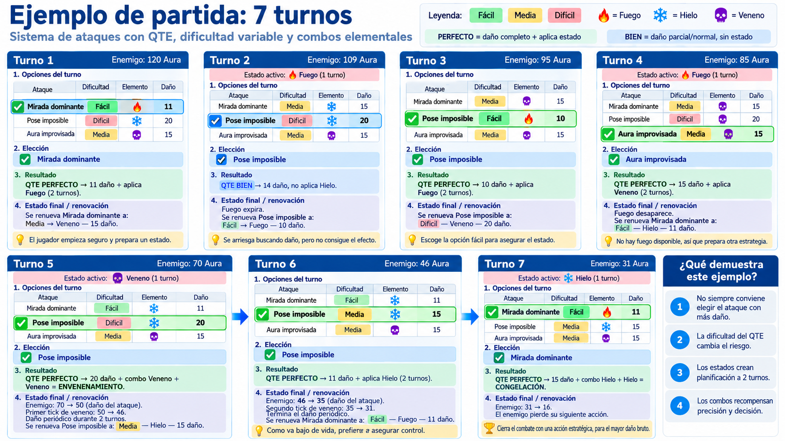 **flow de juego en 7 turnos:** (pendiente de
añadir).

Una partida se compone de una sucesión de combates individuales. En cada uno de ellos el jugador debe interpretar el estado actual del enfrentamiento y tomar decisiones a corto y medio plazo.

Al comenzar su turno conoce la próxima Intención del rival y dispone de tres variantes ofensivas. Puede elegir una opción sencilla para asegurar daño, intentar una variante más difícil y potente o priorizar un elemento que le permita completar un combo.

Este sistema favorece la aparición de situaciones en las que la opción con mayor daño base no es necesariamente la mejor.

Por ejemplo, frente a un enemigo que prepara un ataque peligroso o que haga daño significativo, el jugador puede decidir utilizar una variante de Hielo menos potente para intentar completar un combo de Congelación que hubiera en marcha y cancelar la próxima acción rival.

Añadido a esto, el Favor del Público, el Gashapon y la posible disponibilidad de Improvisación Protectora añaden nuevas variables sin sustituir esta decisión principal.

# 8. Dinámicas

De manera inicial contaremos con varias dinámicas que controlan el feedback que el jugador reciba y con ello tenga que adaptar más o menos su estilo de juego.

## 8.1 Favor del Público

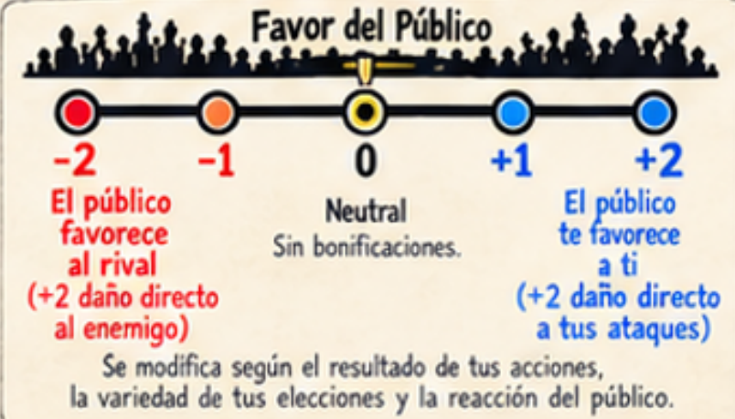

El Favor del Público representa qué contendiente está dominando visualmente el enfrentamiento con un medidor que evoluciona con el enfrentamiento:

**−2 · −1 · 0 · +1 · +2**

Comienza cada combate en posición neutral.

El resultado de las acciones modifica su posición:

| Cuando actúa Paquito: | Cuando actúa el enemigo: |
| :--- | :--- |
| **Perfecto:** +1 hacia Paquito. **Bien:** sin cambio. **Fallo:** +1 hacia el enemigo. | **Perfecto:** +1 hacia el enemigo. **Bien:** sin cambio. **Fallo:** +1 hacia Paquito. |

Al alcanzar el extremo correspondiente, el contendiente favorecido obtiene un +1 adicional de daño directo.

El medidor no puede superar sus valores máximo o mínimo, para evitar un desbalance exagerado. Además, el Favor del Público solo afecta al daño directo de los ataques. No se aplica al daño de los combos de estado como Fuego o Veneno y tampoco a los efectos del Gashapon.

Al comenzar un nuevo combate el Favor del Público regresa a posición neutral.

# 9. Estética y contenido

El arte podríamos dividirlo en dos partes:

Por un lado, los personajes y escenarios se representan mediante pixel art moderno, buscando sprites legibles y expresivos.

Por otro, la interfaz y algunos recursos auxiliares adoptan un acabado de papel, boceto y falso dibujo manual, con garabatos, marcos irregulares y notas visuales que refuerzan la personalidad del juego.

Con todo ello, nos apoyaremos en el falso dibujo a mano y Pixel Art generados mediante IA moderna manteniendo una coherencia de estilo.

Se añadirán, a medida que el diseño requiera, efectos de sonido e hilo musical para los combates tratando de encajarlos en cada uno de los enfrentamientos de manera particular.

# 10. Referencias

El estilo de combate estará basado en los de los juegos **Mario y Luigi**, con el combate por turnos y las acciones que piden Quick Time Events.

Mientras que el estilo de ir completando oleadas de enemigos para llegar al jefe está basado en los combates de **Angry Birds Epic**.

La selección de ataques dentro de un pequeño catálogo posible así como el potenciador a modo de Gashapon están apoyados en el sistema de combate omnipresente en la saga **Final Fantasy**, como por ejemplo en **Crisis Core**.
